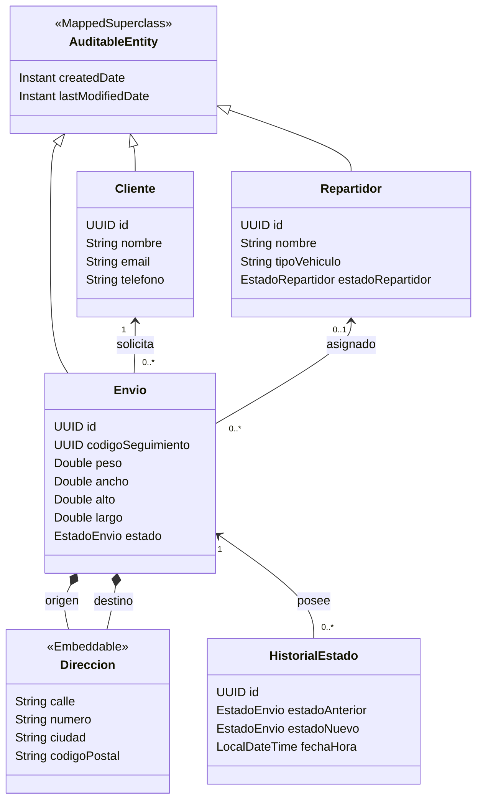

<h1 align="center">📦 Sistema LogiTrack - Servicio de Envíos</h1>

 
  <strong>Desarrollo y Arquitecturas Avanzadas de Software</strong>  
  Ingeniería en Informática · Universidad Nacional de Jujuy   
   
   
   
   
   
   
   

<h2>📌 Descripción</h2>

 Microservicio de gestión y seguimiento de envíos desarrollado para la asignatura <strong>Desarrollo y Arquitecturas Avanzadas de Software</strong> de la carrera Ingeniería en Informática de la Universidad Nacional de Jujuy. 

 El proyecto modela el núcleo de un sistema logístico (LogiTrack), contemplando la gestión de clientes, repartidores, envíos y el historial de cambios de estado de los paquetes, asegurando su persistencia mediante JPA/Hibernate sobre MySQL. 

La implementación aplica conceptos de:

<ul> 
  <li>Programación Orientada a Objetos y Arquitectura en Capas.</li> 
  <li>Relaciones entre entidades y objetos de valor (Embeddables).</li> 
  <li>Tipos enumerados y validación de datos.</li> 
  <li>Persistencia mediante Jakarta Persistence (JPA).</li> 
  <li>Auditoría automática de entidades (JPA Auditing).</li> 
  <li>Eventos de dominio (Spring Events) para el registro histórico.</li> 
  <li>Manejo global de excepciones.</li> 
  <li>Pruebas unitarias y de integración.</li> 
  <li>Contenerización mediante Docker y Docker Compose.</li> 
</ul>

<h2>🚚 Dominio del sistema</h2>

 El sistema representa las entidades clave en el ciclo logístico de envíos. 

<h3>👤 Clientes</h3>

 Un <code>Cliente</code> representa a la persona que solicita un envío. Cada cliente posee: 

<ul> 
  <li>Identificador UUID.</li> 
  <li>Nombre completo.</li> 
  <li>Email (Único).</li> 
  <li>Teléfono.</li> 
  <li>Datos de auditoría (Creación y modificación).</li> 
</ul>

<h3>🛵 Repartidores</h3>

 Un <code>Repartidor</code> es el encargado de transportar los envíos. Posee: 

<ul> 
  <li>Identificador UUID.</li> 
  <li>Nombre completo.</li> 
  <li>Tipo de vehículo.</li> 
  <li>Estado: <code>ACTIVO</code> o <code>INACTIVO</code>.</li> 
</ul>

<h3>📦 Envíos</h3>

 La entidad central <code>Envio</code> representa un paquete a transportar. Incluye: 

<ul> 
  <li>Identificador UUID.</li> 
  <li>Código de seguimiento (UUID único).</li> 
  <li>Dimensiones y peso (alto, ancho, largo).</li> 
  <li>Dirección de Origen y Destino (Objetos Embebidos).</li> 
  <li>Cliente asociado y Repartidor asignado.</li> 
  <li>Estado del envío.</li> 
</ul>

El ciclo de vida de un envío transita por los siguientes estados (<code>EstadoEnvio</code>):

<ul> 
  <li><code>PENDIENTE</code></li> 
  <li><code>EN_RUTA</code></li> 
  <li><code>ENTREGADO</code></li> 
  <li><code>CANCELADO</code></li> 
</ul>

<h3>📜 Historial de Estados</h3>

 Para garantizar la trazabilidad, se registra cada transición mediante la entidad <code>HistorialEstado</code>, la cual almacena: 

<ul> 
  <li>Envío referenciado.</li> 
  <li>Estado anterior y Estado nuevo.</li> 
  <li>Fecha y hora exacta del cambio.</li> 
</ul>

<h2>🧱 Arquitectura</h2>

 La aplicación sigue un diseño multicapa basado en REST, utilizando DTOs para el aislamiento del dominio y Eventos de Spring para desacoplar el registro histórico. 

<pre><code>┌─────────────────────────────┐
│       Capa Controlador      │
│  Endpoints REST / Swagger   │
└──────────────┬──────────────┘
               │
┌──────────────▼──────────────┐
│        Capa Servicio        │
│   Lógica de Negocio + DTOs  │
└──────────────┬──────────────┘
               │ Eventos
┌──────────────▼──────────────┐
│         Repository          │
│ Spring Data JPA / Hibernate │
└──────────────┬──────────────┘
               │
┌──────────────▼──────────────┐
│            MySQL            │
│  Base de datos Relacional   │
└─────────────────────────────┘</code></pre>

<h2>🛠️ Tecnologías</h2>

<table> 
  <thead> 
    <tr> <th>Tecnología</th> <th>Versión / Uso</th> </tr> 
  </thead> 
  <tbody> 
    <tr> <td><strong>Java</strong></td> <td>25</td> </tr> 
    <tr> <td><strong>Spring Boot</strong></td> <td>3.5.14</td> </tr> 
    <tr> <td><strong>Spring Data JPA</strong></td> <td>Persistencia y repositorios</td> </tr> 
    <tr> <td><strong>MySQL</strong></td> <td>8.4</td> </tr> 
    <tr> <td><strong>Docker & Compose</strong></td> <td>Contenerización de BD y App</td> </tr> 
    <tr> <td><strong>Lombok</strong></td> <td>Generación de código (Getters/Setters/Builders)</td> </tr> 
    <tr> <td><strong>Springdoc OpenAPI</strong></td> <td>Documentación automática de API</td> </tr> 
    <tr> <td><strong>JUnit 5 & H2</strong></td> <td>Pruebas automatizadas</td> </tr> 
  </tbody> 
</table>

<h2>🗄️ Persistencia e integridad</h2>

 El mapeo objeto-relacional se realiza con Hibernate. 

<h3>Identificadores y Base de Datos</h3>

 Todas las entidades utilizan identificadores de tipo <code>UUID</code> generados automáticamente. Para optimizar el rendimiento en MySQL 8, estos se almacenan como <code>BINARY(16)</code>. El script inicial (<code>init.sql</code>) define explícitamente las tablas, claves foráneas, restricciones de unicidad (ej. email y código de seguimiento) y validaciones CHECK para los estados. 

<h3>Objetos Embebidos (Embeddables)</h3>

 La dirección se modela como un objeto de valor (Value Object) <code>Direccion</code> utilizando la anotación <code>@Embeddable</code>. Esto permite que los atributos <code>calle</code>, <code>numero</code>, <code>ciudad</code> y <code>codigoPostal</code> se almacenen directamente en la tabla de envíos, agrupando lógicamente el concepto en el dominio Java. 

<h2>🔗 Relaciones y Eventos</h2>

<h3>Cliente — Envío — Repartidor</h3>

 Un cliente puede realizar múltiples envíos (1:N) y un repartidor puede tener asignados múltiples envíos (1:N). La entidad <code>Envio</code> actúa como propietaria de estas relaciones mediante claves foráneas. 

<h3>Desacoplamiento con Spring Events</h3>

 Cuando un envío cambia de estado, en lugar de inyectar dependencias directas, el servicio de envíos publica un evento de dominio (<code>EnvioEstadoCambiadoEvent</code>). Un <i>Listener</i> especializado (<code>HistorialEstadoListener</code>) captura este evento y persiste el nuevo registro en la tabla <code>historial_estados</code>. 

<h2>🕒 Auditoría</h2>

 Las entidades principales extienden la clase base abstracta <code>AuditableEntity</code> (marcada con <code>@MappedSuperclass</code>). 

A través de JPA Auditing se registran de forma transparente:

<pre><code class="language-java">@CreatedDate
private Instant createdDate;

@LastModifiedDate
private Instant lastModifiedDate;</code></pre>

<h2>📐 Modelo de dominio</h2>

A continuación se presenta una aproximación del modelo de clases. Puedes consultar también el archivo adjunto <code>Diagra de Clases - LogiTrack.jpg.jpeg</code> para visualizar el diagrama completo original.

<h2>⚙️ Requisitos previos</h2>

Para ejecutar el proyecto, se requiere contar con:

<ul> 
  <li>JDK 25</li> 
  <li>Docker y Docker Compose (Recomendado para el entorno completo)</li> 
  <li>Alternativa: MySQL 8.4 local</li> 
</ul>

<h2>▶️ Ejecución del Proyecto</h2>

El proyecto incluye configuración completa para ejecutarse mediante Docker.

<h3>1. Configurar variables de entorno</h3>

Crear un archivo <code>.env</code> en la raíz del proyecto basándose en la plantilla:

<pre><code class="language-bash">cp .env.example .env</code></pre>

<h3>2. Ejecutar con Docker Compose</h3>

Construir e iniciar los contenedores (MySQL y la aplicación):

<pre><code class="language-bash">docker-compose up --build -d</code></pre>

 La aplicación estará disponible en <code>http://localhost:8080</code>. Puede acceder a la documentación interactiva Swagger en <code>http://localhost:8080/swagger-ui.html</code>. 

<h3>Alternativa local (Maven Wrapper)</h3>

Si desea ejecutar solo la app localmente contra una base de datos externa:

<pre><code class="language-bash">.\mvnw spring-boot:run</code></pre>

<h2>🧪 Testing</h2>

El proyecto incorpora una sólida batería de pruebas unitarias y de integración que verifican la capa de controladores (WebMvc), repositorios (Slice), y lógica de servicios.

<strong>Para ejecutar todos los tests:</strong>

<pre><code class="language-powershell">.\mvnw test</code></pre>

<h2>👨‍💻 Autores</h2>

<ul> 
  <li><strong>Soliz Mauro Francisco</strong></li> 
  <li><strong>Tolaba Catari Facundo Ezequiel</strong></li> 
  <li><strong>Velásquez Nicolás Santiago</strong></li> 
</ul>

 <strong>Ingeniería en Informática — UNJu</strong>  
Desarrollo y Arquitecturas Avanzadas de Software · 2026 

<em>Proyecto académico</em>
