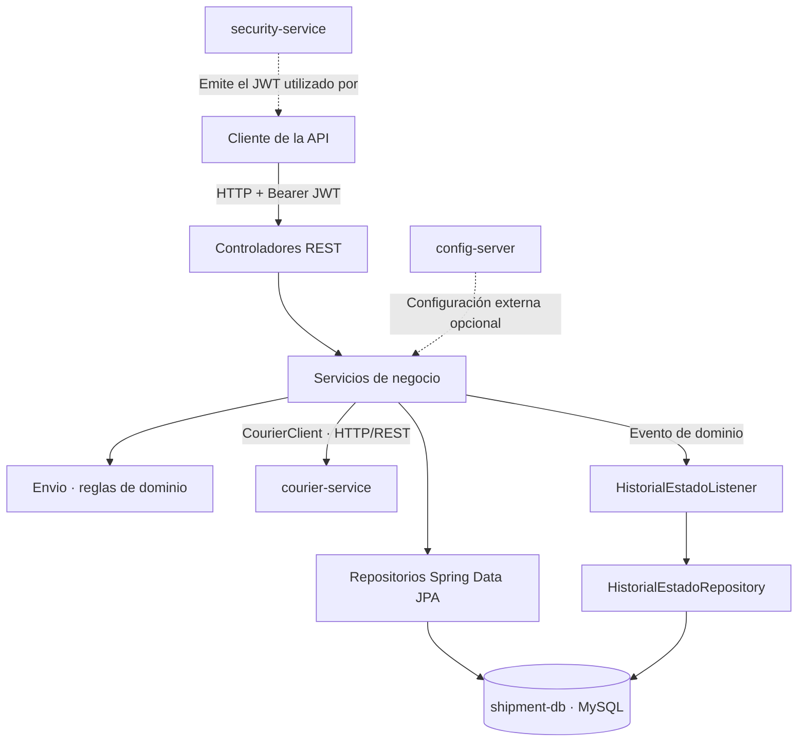
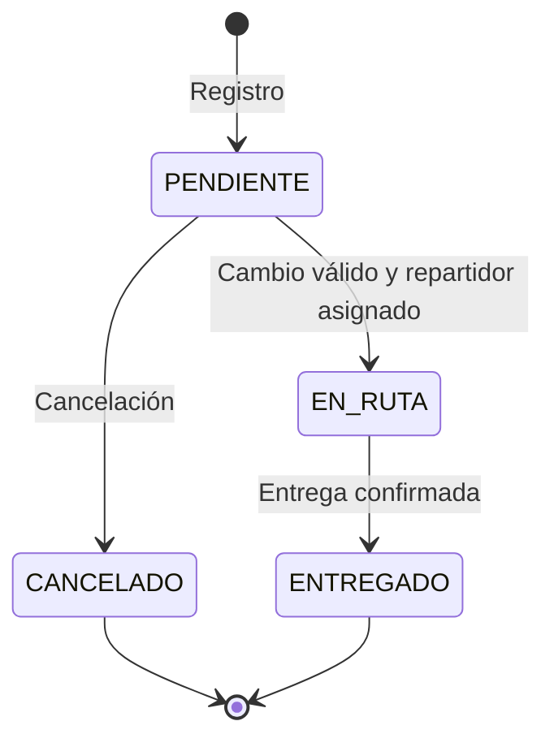
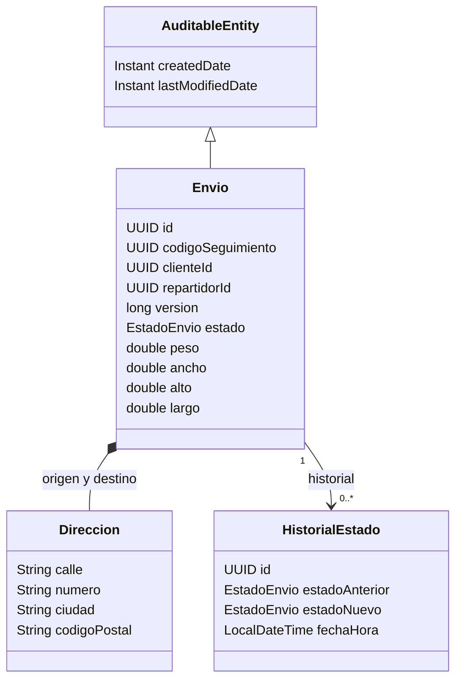
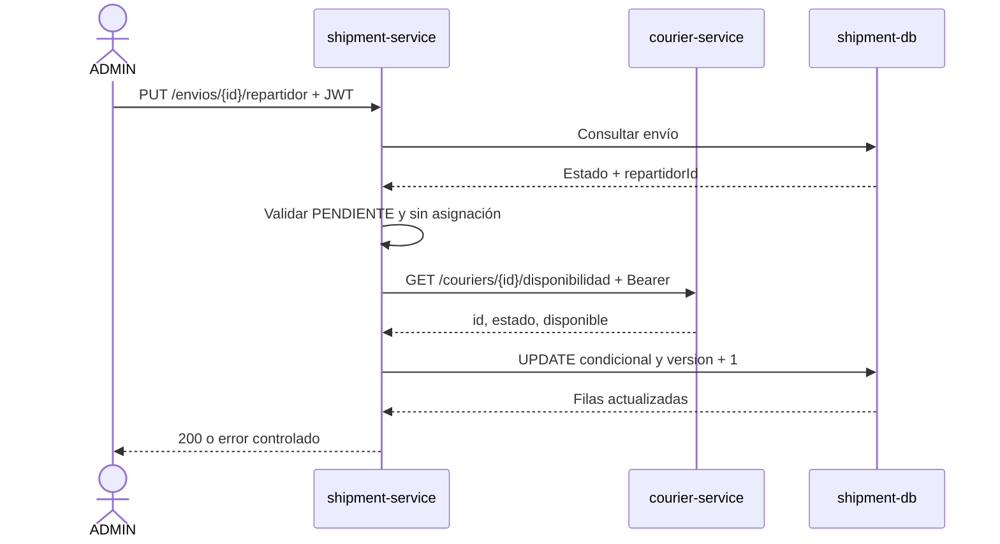

<div align="center">

# 📦 LogiTrack

### SHIPMENT SERVICE

**Gestión y seguimiento de envíos · Arquitectura de microservicios**

**Desarrollo y Arquitecturas Avanzadas de Software · Sprint 2**  
Ingeniería en Informática · Universidad Nacional de Jujuy

<br>


<br><br>

<a href="#inicio-rapido"></a>
<a href="#arquitectura"></a>
<a href="#api-rest"></a>
<a href="#pruebas"></a>

</div>

---

## Descripción general

**`shipment-service`** es el microservicio de LogiTrack encargado de **registrar, consultar, asignar, cancelar y realizar el seguimiento de envíos**. Expone una API REST con Java y Spring Boot, ejecuta las reglas del ciclo de vida de cada paquete y persiste la información propia del servicio mediante Spring Data JPA/Hibernate sobre MySQL.

En el **Sprint 2**, LogiTrack evoluciona desde una solución con responsabilidades concentradas hacia servicios independientes, con contratos HTTP y bases de datos separadas.

<table>
<tr>
<td width="50%" valign="top">
  <strong>📦 Este repositorio · <code>shipment-service</code></strong>
  <ul>
    <li>Registro y consulta de envíos.</li>
    <li>Códigos de seguimiento y cambios de estado.</li>
    <li>Cancelación y asignación de repartidores.</li>
    <li>Autorización por rol y pertenencia.</li>
    <li>Historial, auditoría y persistencia.</li>
  </ul>
</td>
<td width="50%" valign="top">
  <strong>🔗 Servicios externos</strong>
  <ul>
    <li><code>courier-service</code>: administra repartidores y disponibilidad.</li>
    <li><code>security-service</code>: administra usuarios, credenciales, roles y emite JWT.</li>
    <li><code>config-server</code>: centraliza configuración externa.</li>
  </ul>
</td>
</tr>
</table>

> [!IMPORTANT]
> **Límite de responsabilidad:** `shipment-service` **no crea ni administra usuarios o repartidores**. Conserva sus identificadores UUID y consulta la disponibilidad de repartidores mediante HTTP/REST. **No comparte entidades JPA ni claves foráneas entre bases de microservicios.**

> [!NOTE]
> El cálculo de tarifas **no está incluido en el alcance implementado de esta versión**, conforme a la decisión de alcance del equipo.

### Contenido

<table>
<tr>
<td valign="top" width="50%">
  <ul>
    <li><a href="#arquitectura">Arquitectura</a></li>
    <li><a href="#dominio-y-ciclo-de-vida">Dominio y ciclo de vida</a></li>
    <li><a href="#seguridad-y-permisos">Seguridad y permisos</a></li>
    <li><a href="#api-rest">API REST</a></li>
    <li><a href="#integración-con-courier-service">Integración con courier-service</a></li>
  </ul>
</td>
<td valign="top" width="50%">
  <ul>
    <li><a href="#auditoría-y-persistencia">Auditoría y persistencia</a></li>
    <li><a href="#stack-tecnológico">Stack tecnológico</a></li>
    <li><a href="#inicio-rápido">Inicio rápido</a></li>
    <li><a href="#pruebas">Pruebas</a></li>
    <li><a href="#alcance-y-verificaciones">Alcance y verificaciones</a></li>
  </ul>
</td>
</tr>
</table>

---

## Arquitectura

El servicio aplica una **arquitectura en capas**: controladores para HTTP, servicios para reglas de negocio, entidades de dominio y repositorios para persistencia. Las integraciones externas se encapsulan detrás de interfaces específicas.



**Seguridad:** `shipment-service` valida el JWT **localmente con una clave pública RSA**. La emisión del token corresponde a `security-service`; el diagrama no representa ninguna consulta HTTP a ese servicio por cada solicitud.

<details>
<summary><strong>Ver responsabilidades de los componentes Java</strong></summary>

<br>

| Componente | Responsabilidad |
|:--|:--|
| `EnvioController` / `AsignacionController` | Exponen endpoints y reciben DTOs de entrada. |
| `EnvioServiceImpl` | Registro, consultas, cancelación, cambios de estado y control de pertenencia. |
| `AsignacionServiceImpl` | Valida la asignación y coordina la consulta de disponibilidad. |
| `CourierClient` / `CourierClientImpl` | Definen y ejecutan la integración HTTP con `courier-service`. |
| `Envio` / `EstadoEnvio` | Representan el envío y sus reglas de dominio. |
| `EnvioRepository` | Persistencia, filtros y actualización condicional para asignaciones. |
| `EnvioEstadoCambiadoEvent` / `HistorialEstadoListener` | Evento y registro del historial de cambios de estado. |
| `SecurityConfig` | Validación JWT RS256 y reglas de acceso por rol. |
| `GlobalExceptionHandler` | Traducción de errores de aplicación a respuestas HTTP. |

</details>

---

## Dominio y ciclo de vida

### Entidad central: `Envio`

<table>
<tr><th align="left">Datos del envío</th><th align="left">Identidad y control</th></tr>
<tr>
<td valign="top">
  <ul>
    <li><code>origen</code>, <code>destino</code>: objetos <code>Direccion</code> embebidos (<code>@Embeddable</code>).</li>
    <li><code>peso</code>, <code>ancho</code>, <code>alto</code>, <code>largo</code>: características del paquete.</li>
    <li><code>estado</code>: estado actual del ciclo de vida.</li>
  </ul>
</td>
<td valign="top">
  <ul>
    <li><code>id</code>: identificador UUID.</li>
    <li><code>codigoSeguimiento</code>: UUID único de seguimiento.</li>
    <li><code>clienteId</code>: referencia UUID del cliente.</li>
    <li><code>repartidorId</code>: referencia UUID del repartidor; admite <code>null</code>.</li>
    <li><code>version</code>: control de concurrencia mediante <code>@Version</code>.</li>
    <li><code>createdDate</code> / <code>lastModifiedDate</code>: campos de auditoría.</li>
  </ul>
</td>
</tr>
</table>

`DireccionDto` representa las direcciones recibidas y permite convertirlas a `Direccion`. `EnvioResponse` transforma la entidad en una respuesta API sin exponer entidades pertenecientes a otros microservicios.

### Máquina de estados



<table>
<tr><th>Estado actual</th><th>Transición permitida</th><th>Condición destacada</th></tr>
<tr><td><code>PENDIENTE</code></td><td><code>EN_RUTA</code></td><td>Debe haber repartidor asignado.</td></tr>
<tr><td><code>PENDIENTE</code></td><td><code>CANCELADO</code></td><td>La cancelación solo es válida desde PENDIENTE.</td></tr>
<tr><td><code>EN_RUTA</code></td><td><code>ENTREGADO</code></td><td>Se registra la transición.</td></tr>
<tr><td><code>ENTREGADO</code> / <code>CANCELADO</code></td><td>Ninguna</td><td>Son estados finales.</td></tr>
</table>

**Asignación y cambio de estado son operaciones diferentes:** asignar un repartidor **no cambia automáticamente** el envío a `EN_RUTA`. Las transiciones inválidas se rechazan con `409 Conflict`.

<details>
<summary><strong>Ver modelo de clases simplificado</strong></summary>

<br>



**`Cliente` y `Repartidor` no son entidades JPA locales de este repositorio.** La asociación se expresa mediante sus UUID, sin relaciones JPA ni claves foráneas hacia las bases de otros microservicios.

</details>

---

## Seguridad y permisos

<div align="center">


</div>

`shipment-service` funciona como **OAuth2 Resource Server**. Verifica localmente la firma del JWT con clave pública RSA, el algoritmo **RS256**, el emisor (`iss`), la expiración (`exp`) y los claims del contrato:

- `sub`: UUID del usuario autenticado.
- `roles`: lista con un único valor entre `ADMIN`, `CLIENTE` o `REPARTIDOR`.
- `Authorization: Bearer <token>`: cabecera requerida para endpoints de negocio.

### Matriz de autorización

| Operación | `ADMIN` | `CLIENTE` | `REPARTIDOR` |
|:--|:--:|:--:|:--:|
| Registrar envío | Sí¹ | Sí² | No |
| Listar todos los envíos | Sí | No | No |
| Consultar por ID o tracking | Sí | Solo propios | Solo asignados |
| Cancelar | Si está pendiente | Solo propio y pendiente | No |
| Cambiar estado | Según reglas | No | Solo asignados³ |
| Asignar repartidor | Sí | No | No |

<sub>¹ El administrador indica el `clienteId` destinatario. ² Para CLIENTE, el propietario se obtiene de `sub` en el JWT, sin confiar en un `clienteId` del cuerpo. ³ El repartidor no puede cancelar por cambio de estado.</sub>

La **autenticación, emisión de tokens y gestión de credenciales** pertenecen a `security-service`. Este repositorio se ocupa de **validarlos y autorizar operaciones**. Swagger/OpenAPI y el endpoint de salud indicado en `SecurityConfig` permiten consulta sin autenticación.

---

## API REST

<div align="center">


</div>

<br>

| Método | Endpoint | Función | Rol principal |
|:--:|:--|:--|:--|
| `POST` | `/envios` | Registrar envío · `201` | CLIENTE, ADMIN |
| `GET` | `/envios` | Listar; filtro `?estado=` | ADMIN |
| `GET` | `/envios/{id}` | Consultar por UUID | Rol y pertenencia |
| `GET` | `/envios/seguimiento/{codigoSeguimiento}` | Consultar por tracking | Rol y pertenencia |
| `PATCH` | `/envios/{id}/estado` | Cambiar estado | ADMIN, REPARTIDOR asignado |
| `PATCH` | `/envios/{id}/cancelacion` | Cancelar envío · `204` | ADMIN, CLIENTE propietario |
| `PUT` | `/envios/{envioId}/repartidor` | Asignar repartidor · `200` | ADMIN |

<div align="center">

<a href="http://localhost:8083/swagger-ui.html"></a>
<a href="http://localhost:8083/v3/api-docs"></a>

<sub>Los enlaces locales funcionan cuando el servicio está iniciado en el puerto 8083.</sub>

</div>

<details>
<summary><strong>📨 Ejemplo: registrar un envío</strong> — <code>POST /envios</code></summary>

<br>

Con un token Bearer válido de un usuario `CLIENTE`:

```json
{
  "origen": {
    "calle": "Belgrano",
    "numero": "123",
    "ciudad": "San Salvador de Jujuy",
    "codigoPostal": "4600"
  },
  "destino": {
    "calle": "Alvear",
    "numero": "456",
    "ciudad": "San Salvador de Jujuy",
    "codigoPostal": "4600"
  },
  "peso": 2.5,
  "ancho": 20,
  "alto": 15,
  "largo": 30
}
```

Para un `CLIENTE`, el `clienteId` se toma del JWT. Si la solicitud la realiza un `ADMIN`, debe agregar `"clienteId": "<UUID-del-cliente>"` al cuerpo.

</details>

<details>
<summary><strong>🚚 Ejemplo: asignar repartidor</strong> — <code>PUT /envios/{envioId}/repartidor</code></summary>

<br>

```json
{
  "repartidorId": "<UUID-del-repartidor>"
}
```

Solo se permite a `ADMIN` y cuando el envío continúa `PENDIENTE`, sin asignación previa y con repartidor disponible.

</details>

<details>
<summary><strong>🔁 Ejemplo: cambiar estado</strong> — <code>PATCH /envios/{id}/estado</code></summary>

<br>

```json
{
  "estado": "EN_RUTA"
}
```

La transición debe estar permitida por las reglas de `Envio`; para ingresar a `EN_RUTA` se requiere un repartidor previamente asignado.

</details>

---

## Integración con courier-service

El servicio **no consulta la base de datos de repartidores**: utiliza `CourierClient` como contrato y `CourierClientImpl` como implementación HTTP con `RestClient`.



La escritura se protege con una **actualización condicional atómica**: solo se asigna cuando el envío sigue `PENDIENTE` y `repartidorId IS NULL`. Si otra solicitud se anticipó, se rechaza el intento concurrente. La llamada HTTP no mantiene abierta una transacción de la base de datos de envíos.

### Respuestas HTTP de integración

| Situación | Resultado |
|:--|:--|
| Repartidor disponible y envío asignable | `200 OK` |
| Inactivo/no disponible, conflicto de estado o asignación concurrente | `409 Conflict` |
| Envío o repartidor inexistente | `404 Not Found` |
| `courier-service` responde `401` / `403` | `502 Bad Gateway` |
| Respuesta externa inválida o incompatible | `502 Bad Gateway` |
| Timeout, fallo de conexión o `5xx` remoto | `503 Service Unavailable` |

El cliente HTTP admite **URL y tiempos de espera configurables**, sin reintentos automáticos de asignación.

---

## Auditoría y persistencia

<table>
<tr>
<td width="50%" valign="top">
  <h3>🕒 Auditoría de entidad</h3>
  <p><code>AuditableEntity</code> aporta campos comunes mediante <code>@MappedSuperclass</code>:</p>
  <ul>
    <li><code>@CreatedDate</code>: fecha de creación.</li>
    <li><code>@LastModifiedDate</code>: última modificación.</li>
    <li><code>JpaAuditingConfig</code>: habilita el mecanismo de auditoría JPA.</li>
  </ul>
</td>
<td width="50%" valign="top">
  <h3>📜 Historial de estados</h3>
  <p><code>EnvioEstadoCambiadoEvent</code> representa el alta o cambio de estado. <code>HistorialEstadoListener</code> lo recibe con <code>@EventListener</code> y persiste:</p>
  <ul>
    <li>Estado anterior y estado nuevo.</li>
    <li>Fecha y hora de la transición.</li>
    <li>Referencia al envío.</li>
  </ul>
</td>
</tr>
</table>

El listener participa en una **transacción existente** (`@Transactional(propagation = MANDATORY)`). Al registrar el envío, el estado anterior es `null` y el nuevo es `PENDIENTE`.

> [!NOTE]
> Las actualizaciones masivas JPQL, como el `UPDATE` condicional de la asignación, no ejecutan automáticamente los callbacks de auditoría JPA. El comportamiento de `lastModifiedDate` en ese caso requiere una verificación específica.

### Base de datos y migraciones

- **MySQL 8.4**: persistencia independiente de `shipment-service`.
- **JPA/Hibernate**: entidades locales `Envio` e `HistorialEstado`, consultas y persistencia.
- **Flyway**: cambios versionados de esquema.
- **`ddl-auto: validate`**: validación del esquema en ejecución habitual.
- **UUID**: identificadores representados como `BINARY(16)` en el esquema MySQL.

| Migración | Objetivo |
|:--|:--|
| `V1__create_shipment_schema.sql` | Crear tablas `envios` e `historial_estados`. |
| `V2__normalize_legacy_shipment_schema.sql` | Normalizar restricciones, colaciones e índices heredados. |
| `V3__add_optimistic_version_to_envios.sql` | Añadir columna `version` para concurrencia. |

> [!WARNING]
> **Migrar datos del Sprint 1 exige verificar el esquema real y el historial de Flyway antes de ejecutar scripts.** La existencia de migraciones no demuestra que se hayan validado con todos los registros heredados. La definición actual del esquema se administra con Flyway, no con el antiguo `db/init.sql`.

---

## Stack tecnológico

<div align="center">

| Área | Herramientas |
|:--|:--|
| **Backend** | Java 25 · Spring Boot 3.5.14 · Spring Web · `RestClient` |
| **Seguridad** | Spring Security · OAuth2 Resource Server · JWT RS256 |
| **Dominio y datos** | Jakarta Validation · Spring Data JPA · Hibernate · MySQL 8.4 |
| **Esquema y configuración** | Flyway · Spring Cloud Config Client |
| **Observabilidad y documentación** | Spring Boot Actuator · Springdoc OpenAPI · Swagger UI |
| **Pruebas** | JUnit 5 · Spring Boot Test · Spring Security Test · H2 · Testcontainers |
| **Construcción y despliegue local** | Maven Wrapper · Docker · Docker Compose |

</div>

---

## Inicio rápido

### Requisitos

- **JDK 25**.
- **Docker + Docker Compose** para ejecución con contenedores; o **MySQL 8.4** accesible para ejecución local con Maven.
- **Clave pública RSA válida** correspondiente al emisor de los JWT del entorno.

### 1 · Configurar variables

En Windows PowerShell, desde la raíz del repositorio:

```powershell
Copy-Item .env.example .env
```

Editar el archivo `.env` con las credenciales, ruta de clave pública y URLs correspondientes.

<details>
<summary><strong>Ver variables de entorno principales</strong></summary>

<br>

| Variable | Uso |
|:--|:--|
| `DB_USERNAME`, `DB_PASSWORD` | Credenciales de la base del servicio. |
| `DB_ROOT_PASSWORD` | Inicialización de MySQL en Compose local. |
| `DB_URL` | JDBC para ejecución fuera de Compose. |
| `JWT_PUBLIC_KEY_FILE` | Archivo PEM en el host para montaje en contenedor. |
| `JWT_PUBLIC_KEY_LOCATION` | Recurso PEM leído dentro de la aplicación. |
| `COURIER_SERVICE_URL` | URL base de `courier-service`. |
| `COURIER_CONNECT_TIMEOUT_MS` | Tiempo máximo de conexión HTTP. |
| `COURIER_READ_TIMEOUT_MS` | Tiempo máximo de espera HTTP. |
| `CONFIG_SERVER_URL` | URL de configuración centralizada, si está disponible. |
| `SERVER_PORT` | Puerto del servicio; predeterminado `8083`. |

**No subir** `.env`, contraseñas, claves privadas ni archivos PEM de producción al repositorio. El PEM ubicado en `src/test/resources` se usa exclusivamente en pruebas.

</details>

### 2 · Iniciar con Docker Compose

```powershell
docker compose up --build -d
docker compose ps
```

El Compose de **este repositorio** construye `shipment-service` y levanta **`shipment-db` + `shipment-service`**, exponiendo la aplicación en `http://localhost:8083`.

> [!IMPORTANT]
> Este Compose es **local**, no el Compose integrado de todo LogiTrack. **No inicia** `courier-service`, `security-service` ni `config-server`. La asignación real necesita que `courier-service` sea accesible desde el contenedor. Además, las URLs externas se declaran explícitamente en `docker-compose.yml`: modificar solo `.env` no cambia automáticamente esos valores.

Para detener los servicios **sin eliminar los datos persistidos en volúmenes**:

```powershell
docker compose down
```

### 3 · Alternativa con Maven

Con MySQL y las variables de entorno configuradas en la sesión, incluida la clave pública JWT:

```powershell
.\mvnw.cmd spring-boot:run
```

No ejecutar migraciones sobre una base heredada sin verificar previamente el esquema y el estado de Flyway.

### 4 · Comprobar el servicio

<table>
<tr><th>Recurso</th><th>Dirección local</th></tr>
<tr><td>Healthcheck</td><td><a href="http://localhost:8083/actuator/health"><code>http://localhost:8083/actuator/health</code></a></td></tr>
<tr><td>Swagger UI</td><td><a href="http://localhost:8083/swagger-ui.html"><code>http://localhost:8083/swagger-ui.html</code></a></td></tr>
<tr><td>OpenAPI JSON</td><td><a href="http://localhost:8083/v3/api-docs"><code>http://localhost:8083/v3/api-docs</code></a></td></tr>
</table>

Los endpoints de negocio requieren **JWT Bearer válido** y los permisos correspondientes.

---

## Pruebas

La rama `develop` incluye pruebas organizadas bajo `src/test/java/com/logitrack/shipment/` en las áreas `audit`, `client`, `config`, `controller`, `enums`, `listener`, `model`, `repository` y `service/impl`.

El proyecto utiliza Spring Boot Test, Spring Security Test, H2 y dependencias de Testcontainers para MySQL. **Las pruebas basadas en Testcontainers requieren Docker funcionando.**

```powershell
# Compilar código principal y tests sin ejecutarlos
.\mvnw.cmd -DskipTests test-compile

# Ejecutar la suite completa
.\mvnw.cmd test
```

> [!NOTE]
> El resultado de la suite debe corroborarse ejecutando los tests sobre **el commit que se entrega**. Que los archivos de prueba existan no significa por sí solo que todos hayan finalizado correctamente.

---

## Alcance y verificaciones

Esta documentación refleja los componentes visibles de `shipment-service` en `develop`, **no certifica la integración completa de los cuatro microservicios**.

<details>
<summary><strong>Ver verificaciones técnicas para el cierre del Sprint 2</strong></summary>

<br>

- [ ] Ejecutar satisfactoriamente las pruebas actuales de seguridad, integración HTTP y concurrencia.
- [ ] Validar las migraciones Flyway con una copia de la base heredada, conservando datos necesarios.
- [ ] Probar la integración real con `courier-service`, incluidos fallos de red y errores HTTP.
- [ ] Verificar JWT con las claves y el emisor acordados entre servicios.
- [ ] Revisar las fechas de auditoría en actualizaciones masivas JPQL.
- [ ] Comprobar el flujo end-to-end en el entorno grupal con imágenes publicadas.

</details>

---

<div align="center">

### Autores

**Soliz Mauro Francisco** · **Tolaba Catari Facundo Ezequiel** · **Velásquez Nicolás Santiago**

<br>

**Ingeniería en Informática · Universidad Nacional de Jujuy**  
*Desarrollo y Arquitecturas Avanzadas de Software · 2026*

<sub>LogiTrack · Shipment Service · Sprint 2</sub>

</div>

## Seguimiento de cierre Sprint 2

Consultar [el arranque local y los bloqueos de integración](docs/SPRINT2-ARRANQUE-LOCAL.md)
y [la evidencia de validación de esta rama](docs/SPRINT2-VALIDACION.md).
La base heredada `logitrack` de la sesión fue migrada a V3 con baseline 1 controlado;
no es la base aislada `logitrack_shipment` exigida para la entrega final.
La asignación atómica actualiza también `lastModifiedDate` y `version`.
Los conflictos de bloqueo optimista devuelven 409 con el formato común.
No se declara cierre E2E mientras falten las pruebas y dependencias allí indicadas.
